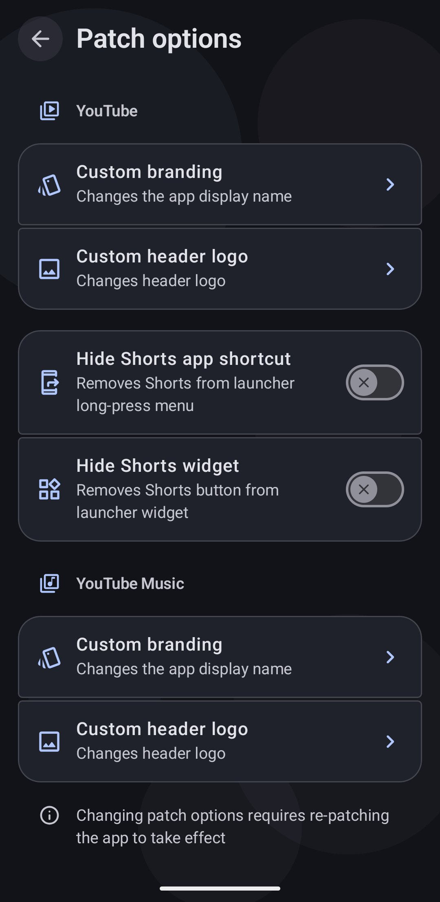
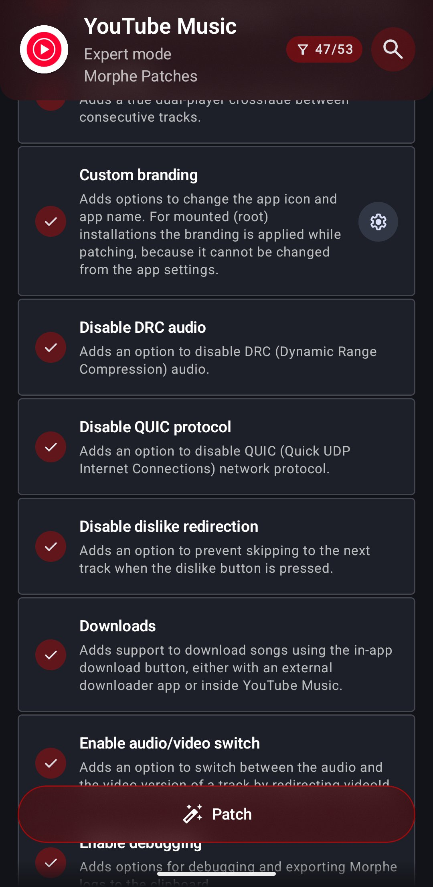
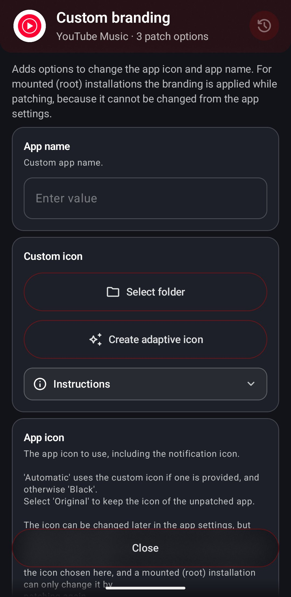
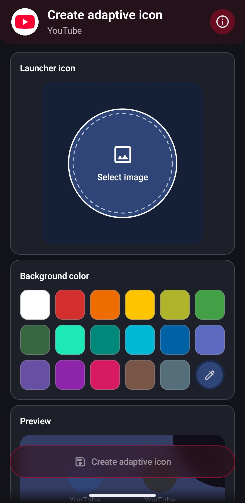
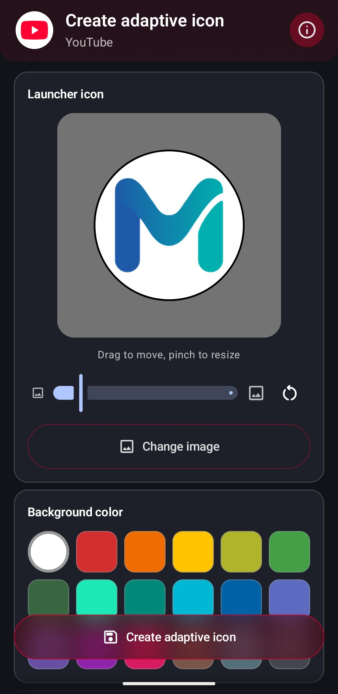
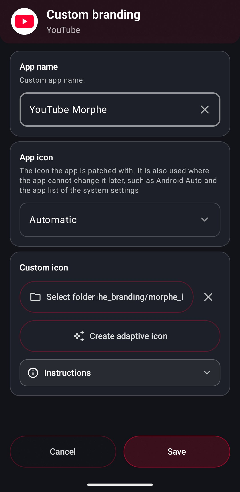
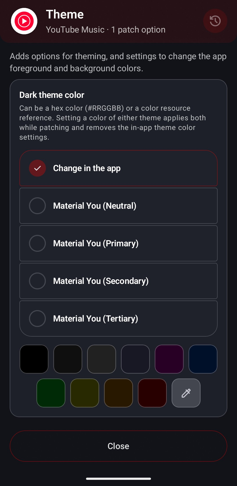

# Creating a custom app icon

The **Custom branding** patch lets you replace the patched app's launcher icon and display
name. Morphe includes an icon creator that turns a single image into a complete adaptive
icon set, so you do not have to prepare density folders by hand.

Where the branding options live depends on your mode, the icon creator itself is identical
in both.

> [!IMPORTANT]
> Branding cannot be changed for mounted (root) installations. Custom icons and names only
> apply to regular installs, see [Root mount](installers.md#root-mount-in-detail).

> [!NOTE]
> Changing these options requires re-patching the app to take effect. Set them up first,
> then patch.

## Where to find the branding options

### Simple mode

Open **Settings → Patch options**. The page lists the options per app, and **Custom
branding** is under the app you want to customize.

  

### Expert mode

Branding lives with the patches instead. On the patch selection screen, find **Custom
branding**, make sure the patch is enabled, and tap the settings icon on its card.

  

## The Custom branding dialog

Both routes open a dialog with the same options. The Expert mode version is shown here.

  

- **App name** - the display name shown under the launcher icon and in the app list. Leave
  it empty to keep the original name. Anything goes, and a name like `YouTube Morphe` makes
  the patched build easy to tell apart from a Play Store one. The X clears the field.
- **App icon** - which icon the app is patched with. **Automatic** uses your custom icon when
  one is set, **Original** keeps the icon of the unpatched app, and the rest are the icons the
  patches bring. The icon can be changed later in the app's own settings, but only for the
  launcher: Android Auto, the app list in the system settings and the APK file always show
  the one chosen here.
- **Select folder** - points the patch at a folder that already contains a prepared icon
  set. Use this if you made the icons yourself or want to reuse a set from an earlier patch.
  Once a folder is set, the button shows its path and an X next to it clears the selection.
- **Create adaptive icon** - opens the icon creator described below. This is the easy route,
  it builds the whole folder structure for you and fills in the path automatically.
- **Instructions** - expands the exact folder layout, file names, and pixel sizes required
  if you prepare the icons manually.

The one difference between the modes is how changes are committed. In Simple mode the dialog
has **Save** and **Cancel** buttons and nothing is stored until you tap **Save**. In Expert
mode the values apply as you set them, **Close** simply dismisses the dialog, and **Reset** in
the header puts the options back to their defaults.

## Preparing your image

The icon creator needs one image, and the requirements matter:

> [!IMPORTANT]
> **Use a PNG with a transparent background.** Only the artwork itself should be opaque,
> everything around it must be transparent. A picture without transparency fills the whole
> icon instead, and Morphe warns you that the themed and notification icons then keep the
> Morphe logo.

The background is not part of your image. It is a separate solid color you pick in the
creator, and that is how Android adaptive icons work: a foreground layer and a background
layer that the launcher moves and masks independently.

> [!NOTE]
> A fully transparent icon background is not possible. Modern launchers do not support it,
> every adaptive icon gets a background layer, so pick a color that suits your artwork.

## Creating the icon

Tap **Create adaptive icon** and the creator opens with three parts: **Launcher icon**, where
you place the artwork, **Background color**, and a **Preview** of the result.

  

### 1. Select the image

**Select image** opens the picker. Choose your transparent PNG, and the editor and the
previews update immediately. **Change image** swaps it later.

### 2. Position and scale it

  

Drag the artwork inside the editor to move it, pinch to zoom, or use the slider below it. The
reset button next to the slider appears once you change anything and puts position and scale
back to the defaults.

The outline on the editor is the icon shape of your launcher, and everything outside it is cut
away. Other launchers use other shapes, so keep the important parts of your artwork inside the
dashed circle, which every shape shows.

### 3. Choose the background color

Pick one of the swatches under **Background color**, or **Custom color** for a color picker of
your own. This is the color behind your transparent foreground, and it fills the entire icon,
including the parts the launcher mask crops away.

### 4. Check the preview

The **Preview** shows the icon the way Android will:

- **Standard** - the launcher icon.
- **Themed** - the version Android 13 and later tints from the wallpaper on launchers with
  themed icons turned on. It follows the same position and scale, so you only adjust once.
- **Notification** - the icon in the status bar, with its own size slider. Status bar icons
  are drawn as a flat silhouette in a single color, whatever your colors are.

### 5. Create

Tap **Create adaptive icon** and pick a folder to save into. Morphe writes the icon set
there while showing a **Creating…** overlay.

Inside the folder you choose, Morphe creates `morphe_branding/morphe_icons_youtube` (or
`morphe_icons_music` for YouTube Music) containing every density variant of the foreground
and background, the monochrome layer, and the notification icons. A `.nomedia` file is added
so the pieces do not show up in your gallery.

## Done

The creator closes and the path to the generated folder is filled into the icon field
automatically, so the patch is ready to use. Fill in **App name** as well if you want a
custom display name.

  

In Simple mode, tap **Save** before leaving. Then patch the app, and the new icon and name
are applied. To reuse the same icon later, point the folder field at that folder again, the
files stay where you saved them.

## Preparing icons manually

If you would rather build the set yourself, **Select folder** accepts any folder with the
correct layout. Tap **Instructions** in the branding dialog for the authoritative list, the
short version is:

- `mipmap-mdpi` through `mipmap-xxxhdpi`, each with
  `morphe_adaptive_background_custom.png` and `morphe_adaptive_foreground_custom.png`
- Sizes per density: 108, 162, 216, 324, and 432 px square
- Optionally `drawable/morphe_adaptive_monochrome_custom.xml` for the themed icon
- Optionally a notification icon, either `drawable/morphe_notification_icon_custom.xml` or
  PNGs in the `drawable-*dpi` folders at 24, 36, 48, 72, and 96 px

Only the densities your device actually uses are required, but including all of them keeps
the set portable.

## Other appearance options

The **Custom branding** dialog is one of several appearance options for the patched app:

- **Custom header logo** - sits next to Custom branding in **Patch options**, and replaces
  the logo in the app's header, see [Creating a custom header logo](custom-header-logo.md).
- **Theme colors** - in Expert mode, the settings icon on the **Theme** patch sets the
  background color of the patched app, for the dark and the light theme where the app has
  both. **Change in the app** leaves the choice to the app's own settings, while a Material You
  preset, one of the swatches, or **Custom color** is applied while patching.

  

All of them need a re-patch to take effect.

## Troubleshooting

| Problem | What to do |
| --- | --- |
| "This image has no transparent pixels" warning | Your PNG has a solid background baked in. Remove it, or the background color you pick will never be visible and the themed and notification icons keep the Morphe logo |
| The icon looks cropped in the launcher | Artwork extends past the dashed circle. Reopen the creator and scale it down |
| The icon did not change after installing | Patch options only apply when the app is patched again. Re-patch with the option set |
| Branding does not apply at all | Mounted (root) installations cannot change branding. Patch in [standard install mode](installers.md#choosing-the-mode) instead |
| The notification icon is a white blob | Status bar icons are silhouettes. Use artwork with clear cutouts instead of a solid shape |

## Next steps

- [Patching an app in Simple mode](patching-simple-mode.md)
- [Patching an app in Expert mode](patching-expert-mode.md)
