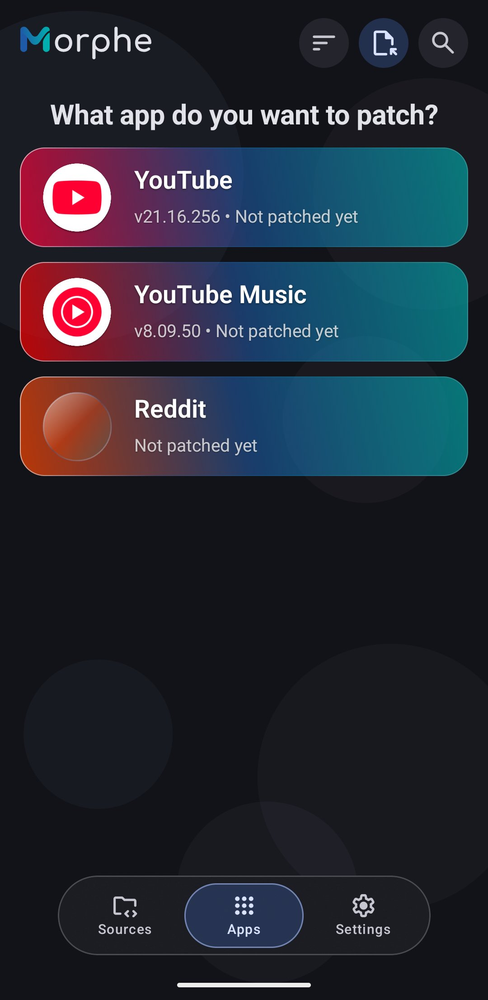

# The home screen and managing apps

The home screen is the app list Morphe opens on. Beyond tapping a card to patch, it lets you
reorder, group, hide, and act on several apps at once, so a long list stays yours.

## The app list

  

Each card shows an app, a version, and quick status. For an app you have patched that is the
version of the patched build; for one you have not, it is the version sitting on your device,
next to **Not patched yet**. A small mark on the app icon appears when newer patches exist or
when the sources support a newer version of the app, and in the second case the card shows the
installed version followed by an arrow and the newer one. **Uninstalled** marks a patched app
that is gone from the device.

Tapping a card starts patching if the app is not patched yet, and opens the app's info
dialog once it is, see [Updating a patched app](updating-patched-apps.md).

Two gestures work directly on a card:

- **Swipe right** - shows the patches available for that app.
- **Swipe left** - hides the card from the home screen.

Long-pressing a card enters multi-select.

The bar at the bottom switches between **Sources**, see [Managing patch sources](patch-sources.md),
**Apps**, this list, and **Settings**. The buttons in the header are **Sort**, **Select other
apps**, and **Search apps**. Long lists get a floating button to jump back to the top.

## Searching and sorting

**Search apps** opens a field that filters the list by app name. **Sort** opens the **Sort and
filter** panel, with three rows: **Sort**, **Filter**, and **Group**. **Sort** offers:

| Order | What it does |
| --- | --- |
| **Recommended order** | Installed and pinned apps first |
| **Manual order** | Your own order, long-press an app and use the reorder button |
| **Name (A-Z)** and **(Z-A)** | Alphabetical, either direction |
| **Patch updates first** | Apps with newer patches on top, then recommended order. A card marked only because the sources support a newer app version stays where it is |
| **Recently patched** | The apps you patched most recently first |

**Filter** narrows the list to apps you have patched, apps you have not, apps currently
installed, apps no longer on the device, or **Clones**, the builds that carry a package name of
their own and sit next to the original app. Filtering is temporary and leaves your order
untouched, and the sort button stays highlighted while one is active. **Reset** in the panel
header puts everything back to the defaults.

## Grouping

**Group** in the same panel adds a switcher above the list, with:

- **None** - one flat list.
- **Sources** - apps grouped by the patch source that provides them, handy when you run more
  than one source.
- **Custom** - your own categories.

Categories are created with **Add category**, renamed, reordered, and deleted from the
switcher. Deleting one moves its apps back to **Uncategorized**, nothing is lost. To fill a
category, select apps and use **Move to category**.

Setting **Group** back to **None** hides the switcher but keeps your categories.

## Hiding apps

Swiping a card left hides it, which is useful for apps you never patch. Morphe confirms the
first time. Hidden apps are not gone: a **Hidden apps** button at the bottom of the list
shows them, and tapping one brings it back.

## Multi-select

Long-press any card to select it, then tap others to add them. The panel that appears shows
how many are selected, with **Select all** and **Cancel** next to the count, and offers:

- **Patch selected** - patches everything you selected in one queue, see
  [Patching several apps at once](batch-patching.md).
- **Patch sources** - decides which of your sources the selected apps are patched from, see
  [Choosing sources per app](patch-sources.md#choosing-sources-per-app).
- **Move to category** - while custom grouping is on.
- **Reorder list** - drag the selected apps into place.
- **Reinstall** and **Uninstall** - shown only when they apply to every selected app.
- **Hide** - takes the selected cards off the home screen.

## Other apps

**Select other apps** in the header opens patching for apps outside the built-in list: pick any
APK from storage, or any app already installed on the device. This is an Expert mode feature,
in Simple mode Morphe tells you so.

Patching such an app only makes sense with universal patches, or with a source that declares
support for it.

## Personal touches

- **Greeting** - the question above the list changes with the time of day. It can be turned
  off with **Greeting phrases** in **Settings → Appearance → Home screen**.
- **Re-patch notice** - the banner above the list when patched apps have fallen behind, see
  [When patches move on](batch-patching.md#when-patches-move-on). It can be turned off in the
  same place.
- **App icons and colors** on the cards come from the app itself or from the patch source's
  metadata.

## Next steps

- [Patching an app in Simple mode](patching-simple-mode.md)
- [Updating a patched app](updating-patched-apps.md)
- [Managing patch sources](patch-sources.md)
