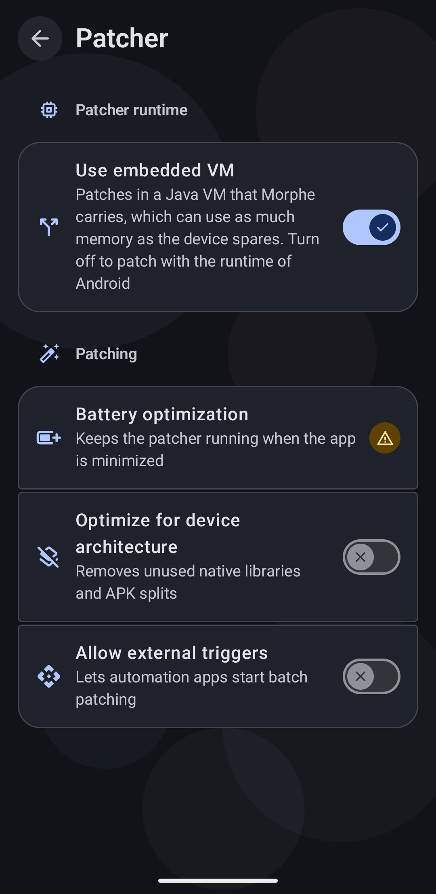

# How patching works and how to tune it

Patching rewrites the app's bytecode and resources on your device. Nothing is uploaded, and
nothing is downloaded except the patches themselves. This guide explains what happens during
a run and which settings change how it behaves, which is what you reach for when patching is
slow or fails on a large app.

## What happens during a run

A patch run moves through three groups of steps, visible as text on the progress screen and
in full detail in the Expert mode log:

1. **Preparing** - Morphe loads the patches, merges the modules if your input was a split
   APK bundle, and reads the APK.
2. **Patching** - each selected patch is applied in turn. This is the long part, and the
   counter shows how far along it is.
3. **Saving** - the patched APK is written and then signed with your keystore, see
   [Backing up Morphe and your keystore](backup-and-keystore.md).

While this runs, Morphe keeps a **Patching in progress** notification so you can leave the
app and come back, and a notification arrives the moment it finishes. **Completion sound** in
**Settings → Notifications** adds a distinct tone for success and failure.

The red button stops the run, with a confirmation. Nothing is installed or changed on your
device until you press Install afterwards.

## Keeping the run alive

Some devices stop background work aggressively. **Battery optimization** in
**Settings → Patcher** lets Morphe run without battery restrictions, and Expert mode asks for
it before the first patch, see
[Allow background patching](patching-expert-mode.md#allow-background-patching). Without it,
keep Morphe in the foreground while patching.

Patching also needs room: at least **1 GB of free storage** for the input, the output, and
temporary files. Morphe warns you before starting if you are below that.

## Patcher runtime

Every run happens in a process of its own, apart from the Morphe app, so a run that fails or
is stopped by the system never takes the app down with it. **Settings → Patcher → Use
embedded VM** decides what runs the patcher inside that process.

  

- **On** (the default) - Morphe patches in a Java VM it carries itself. It can use far more
  memory than Android gives an app: about a third of the device RAM, between 1 GB and 3 GB,
  and up to 1 GB on 32-bit devices.
- **Off** - Morphe patches with the runtime of Android, which gets the same memory an app
  does. Worth trying only if the embedded VM causes problems on your device.

The switch needs an ARM or 64-bit x86 device, elsewhere it stays off. There is nothing to tune
by hand, the memory limit follows from the device.

## Making the output smaller

**Optimize for device architecture** in **Settings → Patcher** drops the native libraries and
split modules your device does not need, which shrinks the result considerably, see
[Optimize for device architecture](patching-expert-mode.md#optimize-for-device-architecture).

## When patching fails

Morphe shows **Patching failed** with the error, and a copy button that puts it on your
clipboard.

For anything you want to report, the Expert mode log is the useful part: it opens with a
summary of app version, patches version, APK size, patch count, split APK or not, runtime and
heap limit, your Android version and device, and free RAM and storage. The copy button at the
bottom of the log takes the whole thing. **Export debug logs** in **Settings → Help & info**
additionally exports full system logs.

| Symptom | What to try |
| --- | --- |
| Out of memory | Keep **Use embedded VM** on, it gives the patcher the most memory. If it still runs out, the app is too large for the selection: patch with fewer patch sources or fewer patches |
| "The system stopped the patcher" | Android ended the patcher, usually to free memory. Close other apps and try again |
| "The patcher crashed" | Try again. If it keeps crashing, turn **Use embedded VM** off and report the issue with the log |
| Patching stops when you leave the app | Allow Morphe to run without battery restrictions |
| "Low disk space" warning or a corrupt output | Free storage, patching wants at least 1 GB |
| Fails right after "Merging split APK" | Split bundles are less reliable than a full APK. Download a full APK if the site offers one |
| The patched app crashes on launch | The selection, not the run, is usually at fault. Patch again with **Enable recommended patches** |
| Every app fails after a source update | Update your patch sources, or restore an earlier selection, see [Managing patch sources](patch-sources.md) |

## Next steps

- [Patching an app in Expert mode](patching-expert-mode.md)
- [Updating a patched app](updating-patched-apps.md)
