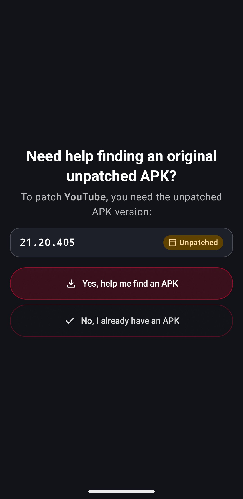
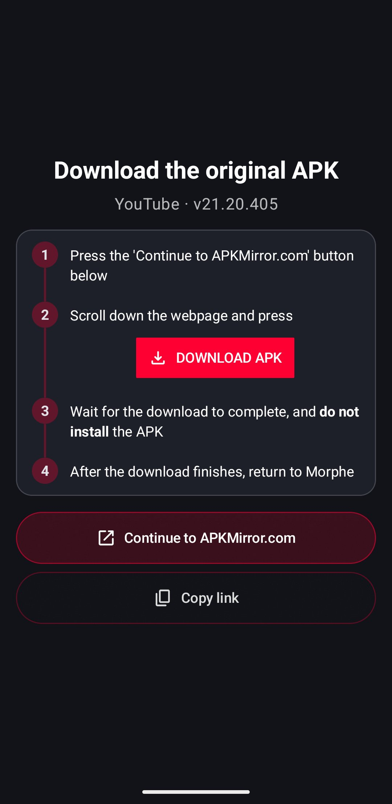
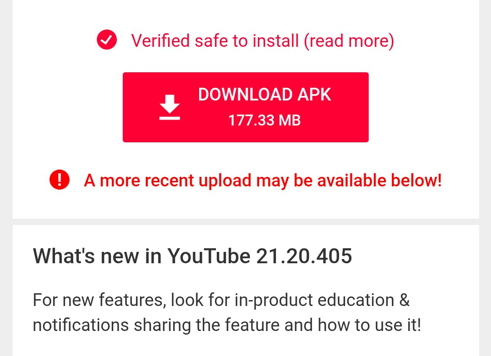
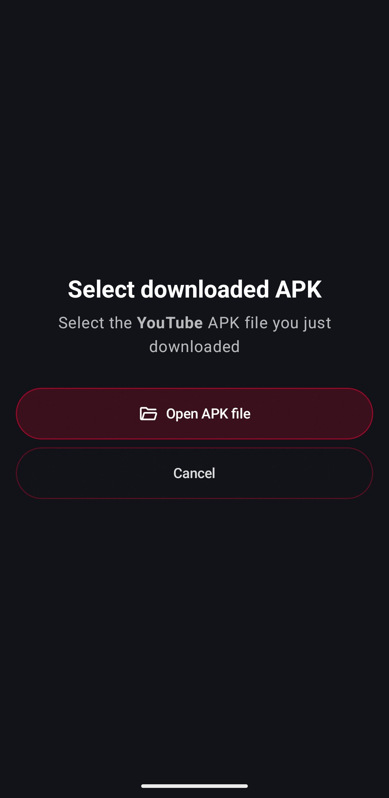
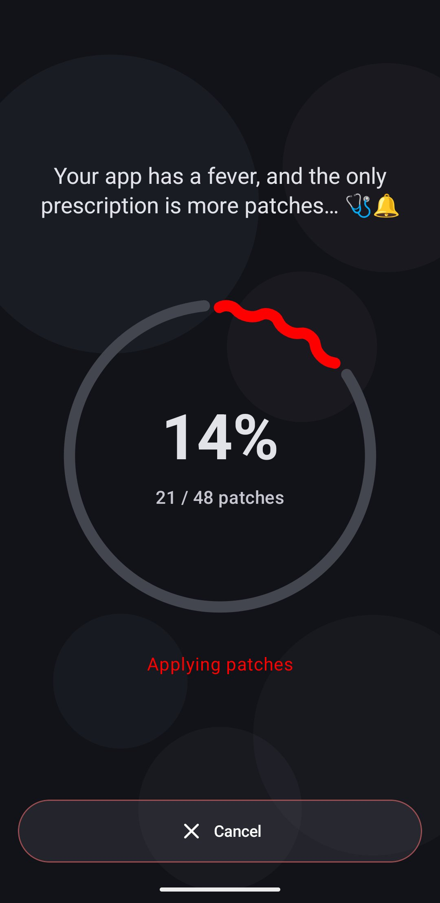
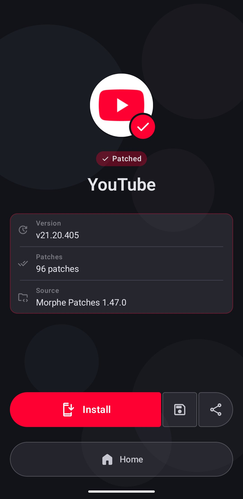
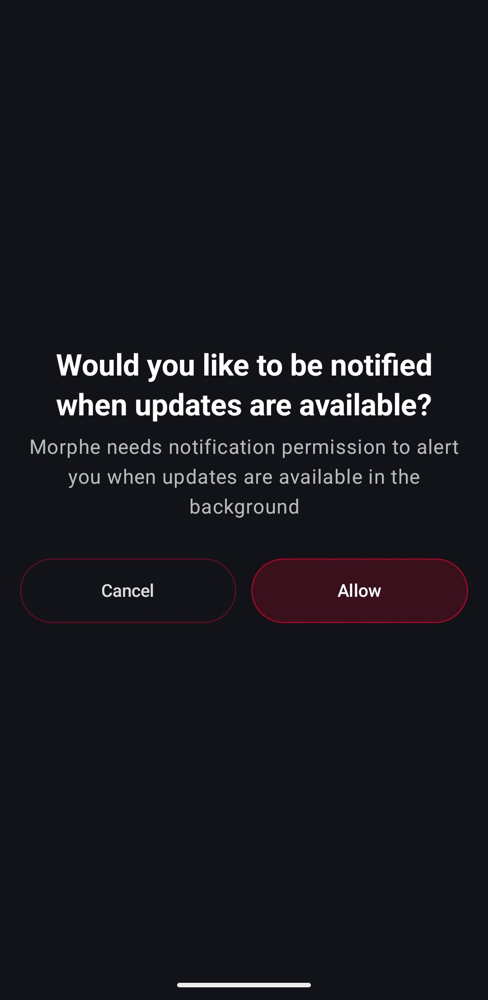
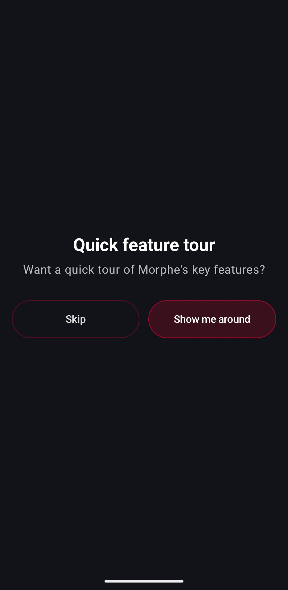

# Patching an app in Simple mode

Simple mode is how Morphe works out of the box. You pick an app, Morphe tells you which
original APK it needs, helps you download it, and applies a curated set of patches with
sensible defaults. There is nothing to configure.

This guide walks through a first patch from start to finish, using YouTube as the example.
The steps are identical for YouTube Music and Reddit.

**Time needed:** about 5 to 10 minutes, most of it spent downloading the original APK.

## Before you start

- **Android 8.0 (API 26) or newer.**
- **At least 1 GB of free storage.** Morphe needs room for the original APK, the patched
  output, and temporary files. It warns you if free space is below this.
- **An internet connection.** Morphe downloads its patch sources on first launch, and you
  will download the original APK from the web.
- **Permission to install unknown apps.** Android asks for this the first time you install
  a patched APK. You can grant it when prompted.

> [!NOTE]
> Everything happens on your device. Morphe never uploads your APKs or personal data.

## 1. Choose the app to patch

Open Morphe. The home screen lists every app Morphe can patch. Tap the one you want, in
this case **YouTube**.

  

Apps you have not patched yet are marked **Not patched yet**, with the version installed on
your device in front of it when the app is there at all.

> [!TIP]
> If more than one of your patch sources provides patches for the same app, Morphe first
> asks you to pick one in a **Select patch source** dialog. Tick **Always use this source for
> this app** and it stops asking for that app. With the default setup this does not happen at
> all, see [Managing patch sources](patch-sources.md).

## 2. Check the required APK version

Morphe now shows which version of the original app the patches are built for, along with an
**Unpatched** badge. Patches are version specific, so this exact version is what you need.

If the app is already on your device, Morphe says which version that is: an **Installed** badge
next to the version when it happens to be the one the patches want, and a line under the list
when it is not.

  

- **Yes, help me find an APK** - Morphe walks you through downloading it. Choose this if
  this is your first patch.
- **No, I already have an APK** - skips straight to the file picker in step 5.

## 3. Follow the download instructions

Morphe explains what to do on the download site. Read the four steps, then tap
**Continue to APKMirror.com**. Morphe opens the correct download page for the required
version in your browser. **Copy link** puts the same address on your clipboard instead, and
with a trusted [download helper](apk-download-helper.md) a **Use a helper app** button is
offered as well.

  

> [!IMPORTANT]
> The red **DOWNLOAD APK** button on this screen is only a picture of what to look for on
> the website. Tapping it does nothing but show you a friendly reminder.

## 4. Download the original APK

On the website, scroll down to the download section and press the real **DOWNLOAD APK**
button.

  

Two things to keep in mind:

- **Do not install the APK** after it downloads. Morphe needs the untouched file.
- **Ignore any "a more recent upload may be available" notice.** Download exactly the
  version Morphe asked for in step 2, not a newer one.

When the download finishes, return to Morphe.

## 5. Select the downloaded APK

Morphe asks for the file you just downloaded. Tap **Open APK file** and pick it in the file
picker, usually from the **Downloads** folder.

  

Morphe verifies the file before continuing and warns you if the package, version, or
signing certificate does not match what the patches expect.

> [!TIP]
> If the file cannot be selected or opened, move it out of **Downloads** to the root of your
> internal storage and try again. You can also switch to
> [Morphe's built-in file picker](file-picker.md).

## 6. Wait for patching to finish

Patching starts automatically. The progress ring shows how many patches have been applied.

  

This usually takes a few minutes and depends on your device. You can leave Morphe in the
background, a notification arrives the moment patching finishes. The red button cancels
the process.

> [!TIP]
> Some devices stop the patcher when the app is minimized. If that happens to you, allow
> Morphe to run without battery restrictions in **Settings → Patcher → Battery optimization**,
> or keep it in the foreground while patching.

## 7. Install the patched app

When patching is done, Morphe switches to the completion screen on its own. Tap **Install**
there.

  

Android takes over from here. If it asks to allow installs from unknown sources, follow the
prompt and grant it, this is required for any app that does not come from the Play Store.

Once the app is installed the screen says so and **Install** turns into **Open**. If the
patched app handles web links that Android has not verified for it, a card offers **Fix
links**, which opens the system setting that lets those links open in the app instead of the
browser.

### Saving and sharing the patched APK

Next to **Install** are two buttons: **Save** writes the finished APK wherever you choose,
and **Share** hands it to another app, so you can keep it, move it to another device, or
reinstall it later without patching again. **Home** returns to the app list.

Morphe also keeps a copy itself while **Keep patched APKs** is on, which it is by default,
see [Storage and saved data](storage-and-saved-data.md#saved-apks).

> [!IMPORTANT]
> The patched app is signed with a different certificate than the original. Whether that
> matters depends on the patches. YouTube and YouTube Music get a package name of their own,
> `app.morphe.android.youtube` for example, and install next to the stock app. A patched app
> that keeps the original package name conflicts with the unpatched one: Morphe reports
> **Uninstall required**, and you have to uninstall the original first, which permanently
> erases its data, including downloads and local settings.

## 8. Two questions after the first install

Once the patched app is installed for the first time, Morphe asks two one-off questions.

### Notifications

  

**Allow** lets Morphe tell you when a new version of Morphe or of your patch sources is
available, even while the app is closed. **Cancel** declines, and update checks then only
happen while you have Morphe open. You can change this later in the Android settings for
Morphe.

### Quick feature tour

  

**Show me around** starts a short guided tour that points out the home screen, the patch
sources, and the main settings. **Skip** dismisses it.

Neither prompt appears again. If you skipped the tour and want it later, start it from
**Feature tour** in **Settings → Help & info**.

## After your first patch

- The home card for the app now shows the patched version, and tapping it opens the app's
  info dialog, see [Updating a patched app](updating-patched-apps.md).
- Patch options such as a custom app name, icon, or header logo are available in
  **Settings → Patch options** while in Simple mode, see
  [Creating a custom app icon](custom-app-icon.md).

## Troubleshooting

| Problem | What to do |
| --- | --- |
| The APK cannot be selected from Downloads | Move it to the root of your internal storage, or enable the [built-in file picker](file-picker.md) |
| "Unsupported Version" warning | You downloaded a different version than the one Morphe asked for. Download the exact version shown in step 2 |
| "Split APK detected" warning | You downloaded a bundle (APKM / APKS / XAPK). A full APK gives the best results, pick another download on the website |
| "Unverified APK" warning | The file does not match the expected signing certificate. Download it again from a trusted source |
| Patching stops when you leave the app | Allow Morphe to run without battery restrictions in **Settings → Patcher → Battery optimization** |
| Patching fails or the app crashes | Update your patch sources and try again. Export debug logs from **Settings → Help & info** when reporting the issue |

## Next steps

- [Patching an app in Expert mode](patching-expert-mode.md), for choosing individual patches
  and configuring their options
- [Choosing how patched apps are installed](installers.md), including silent installs and
  root mount
- [Updating a patched app](updating-patched-apps.md) when new patches arrive
- [The home screen and managing apps](home-screen.md), for sorting, grouping, and hiding
- [How patching works and how to tune it](patching-process.md), when a run is slow or fails
- [Managing patch sources](patch-sources.md), to add patches from other maintainers
- [Backing up Morphe and your keystore](backup-and-keystore.md) before you reinstall or
  switch devices
- [Storage and saved data](storage-and-saved-data.md), to see what Morphe keeps and free
  space
- [Creating a custom app icon](custom-app-icon.md) or
  [header logo](custom-header-logo.md) for the patched app
